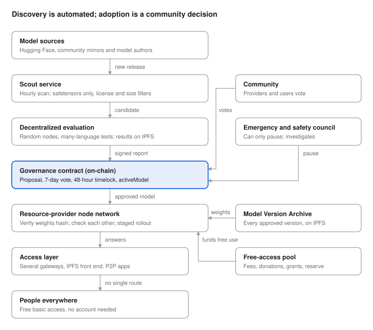

# Community-Governed Decentralized AI: Majority-Controlled Inference with Governed Model Updates

**Abdelrahman Sadek** · November 17, 2026 · Version 2.0

📄 [Download the PDF version](community-governed-decentralized-ai.pdf) · 🛠️ [Phase 0 code and quick start](docs/phase0.md)

## Abstract

We propose an AI system designed so that no single company, government, infrastructure provider or governance body holds unilateral control over it, while its community can stop, correct or upgrade it by majority vote. We treat this as a measurable design objective, not an absolute guarantee. Inference runs off-chain on a network of independent resource providers, while a blockchain holds coordination, payment and governance. Model updates are discovered automatically on Hugging Face, evaluated by randomly selected nodes, and adopted only after an on-chain vote and a timelock. The core principle is that the model executes governance decisions but never makes them: it cannot choose its own successor or influence the vote that controls it. A second founding goal is that the AI is free for all: anyone can use it at no cost, without an account, payment or token, funded by a protected free-access pool.

**Keywords:** decentralized AI, DAO governance, verifiable inference, model supply-chain security, human oversight, open access, AI as a public good

## Contents

1. [Introduction](#1-introduction)
2. [Background and Related Work](#2-background-and-related-work)
3. [System Architecture](#3-system-architecture)
4. [Governance Mechanism](#4-governance-mechanism)
5. [Model Update Pipeline](#5-model-update-pipeline)
6. [Free Access for All](#6-free-access-for-all)
7. [Security Analysis](#7-security-analysis)
8. [Evaluation Plan](#8-evaluation-plan)
9. [Limitations and Open Problems](#9-limitations-and-open-problems)
10. [Implementation Roadmap](#10-implementation-roadmap)
11. [Future Directions](#11-future-directions)
12. [Conclusion](#12-conclusion)
13. [References](#references)

## 1. Introduction

Today's most capable AI systems run on infrastructure controlled by a handful of companies. A single operator can change, restrict or withdraw a model at any time, for commercial, legal or political reasons. This creates a single point of failure and a single point of censorship.

The opposite extreme, an AI that nobody can stop, is not a solution. Every AI system fails in ways its designers did not foresee, and a system that cannot be stopped cannot be fixed. The ability to halt and correct a model is the last line of defense against unexpected behavior.

**Design goals.** The system is built around four goals, in priority order:

1. **Correctable.** The community can always pause, roll back or shut down the system.
2. **No single point of control.** No participant, organization, infrastructure provider, government or governance body holds unilateral control over essential operation, model selection, user access or permanent shutdown. Decentralization alone does not guarantee this, so Section 8 measures it.
3. **Free for all.** Anyone can use the AI at no cost, without an account, payment or token. Paid tiers may add priority or capacity, but never gate basic access.
4. **Transparent.** Every model, vote, evaluation and incident is public and auditable.

This paper argues for a middle path: **no single party should be able to stop the system alone, but the community collectively can.** Our contributions are:

1. A five-layer architecture separating discovery, verification, governance, deployment and access.
2. A bicameral governance mechanism in which both resource providers and users hold voting power.
3. A governed update pipeline that tracks open models on Hugging Face without letting the model update itself.
4. A threat analysis covering Sybil attacks, supply-chain attacks, poisoned models and governance capture.
5. A sustainable free-access model in which basic use is free for everyone and protected by the constitution.
6. An evaluation plan with measurable targets for security, availability and fairness.
7. A comparison with existing decentralized AI projects and a phased roadmap that proves the network works before introducing a token.

## 2. Background and Related Work

**On-chain vs. off-chain inference.** Running a large language model inside a blockchain's execution environment is impractical: one forward pass needs billions of operations, and gas costs would be prohibitive. Practical systems therefore use the chain for coordination and payment, and run inference off-chain on independent nodes. Bittensor and Ritual are projects working in this space.

**Verifiable computation.** A decentralized network must check that a node actually ran the approved model. Three approaches exist:

| Approach | How it works | Trade-off |
| --- | --- | --- |
| zkML | A zero-knowledge proof that the computation was correct | Strongest guarantee; still far too slow for large models |
| opML (optimistic) | Results are accepted unless someone challenges them within a dispute window | Fast; relies on at least one honest verifier |
| TEE | Inference runs inside isolated hardware (Intel TDX, NVIDIA Confidential Computing) | Fast; trusts the hardware vendor |

**DAO governance.** Decentralized autonomous organizations vote on proposals through smart contracts. Known weaknesses include low turnout, token-weighted plutocracy and vote buying. Section 4 addresses each.

**Related projects.** Several projects already run AI on independent hardware. The table summarizes each as its own public pages describe it (checked 2026-11-17).

| Project | What it does | Governance described | Difference from this design |
| --- | --- | --- | --- |
| [Petals](https://petals.dev) | Runs large language models "BitTorrent-style": volunteers each serve part of a model | Part of the BigScience research workshop; no token or voting described | No mechanism for deciding which model runs or how it changes |
| [Bittensor](https://github.com/opentensor/bittensor) | Open-source platform for "competitive digital commodities", including machine intelligence, organized in subnets | Rewards in TAO set by on-chain Yuma Consensus; tools from the Opentensor Foundation | Rewards output quality; no community vote approving a specific model version is described |
| [Ritual](https://ritual.net) | Infrastructure for AI agents running in TEE hardware offered by independent providers | Ritual Foundation; execution paid in its native token | Focused on running agents, not on governing model updates |
| [Akash](https://akash.network) | Open marketplace where independent providers sell compute, including AI inference | Not described on the page reviewed | A compute market; model choice is left to each buyer |

As described on their public pages, none of these projects combines community approval of model versions, a constitutional free-access guarantee and a measured decentralization objective. That combination is this paper's contribution.

## 3. System Architecture

The system has five layers: discovery, verification, governance, deployment and access. Only the governance contract can change which model the network runs.



A new model flows top to bottom and reaches the nodes only after the community vote; the emergency council can pause the contract but cannot approve or change a model. Nodes load weights only from the Model Version Archive, which keeps every approved version (Section 5). The free-access pool funds the nodes' reserved capacity (Section 6), and answers reach people through an access layer with no single route that can be blocked (Section 7.1).

## 4. Governance Mechanism

Governance answers four questions: who votes, how much each vote weighs, which decisions need which majority, and how the system reacts to emergencies.

**4.1 Two chambers.** Resource providers hold physical power: if they switch off their machines, the system stops. Users are affected by the system's decisions but do not run it. If providers voted alone, they could favor their own revenue over users. We therefore use two chambers, and constitutional changes require a majority in both. A third chamber for public-interest institutions such as universities and civil-society groups is attractive, but deciding which institutions qualify would reintroduce a gatekeeper; we leave it as an open question (Section 11).

**4.2 Vote weighting.**

| Scheme | Strength | Weakness |
| --- | --- | --- |
| One vote per device | Simple | Sybil attack: one actor runs 1,000 fake nodes |
| Weighted by compute | Hard to fake | Data centers dominate |
| Weighted by token | Common in DAOs | Plutocracy |
| Quadratic voting | Limits large holders | Needs identity |
| One person, one vote | Fairest | Proof of personhood is hard and touches privacy |

We recommend quadratic voting on verified compute contribution, with a hard cap on the weight of any single participant.

**4.3 Decision tiers.**

| Decision | Threshold | Quorum | Timelock |
| --- | --- | --- | --- |
| Routine parameter change | Simple majority | 10% | 48 hours |
| Model upgrade | Simple majority, both chambers | 15% | 48 hours |
| Resume after emergency pause | Simple majority | 10% | none |
| Permanent shutdown | 66% | 20% | 7 days |
| Constitutional change | 80%, both chambers | 30% | 14 days |

**4.4 Emergency pause.** Votes take days; some problems need minutes. A small elected council, implemented as a 3-of-5 multisig, may pause the network but cannot change, upgrade or unpause it. A majority vote then decides whether to resume. Between emergencies, the council investigates incident reports (Section 4.8), organizes independent red-team exercises and publishes its findings, but it can only recommend; every lasting decision goes to a vote. Its members come from different groups: researchers, security specialists, users and providers.

**4.5 Constitution.** A small set of rules cannot be changed by a simple majority, to prevent tyranny of the majority: for example, a ban on using the model against a specific group, the guarantee that a shutdown vote is always possible, and the guarantee of free basic access for everyone (Section 6).

The constitution also lists the rights every user holds. Changing any of them needs the constitutional threshold in Section 4.3.

| Right | Protection |
| --- | --- |
| Free access | Basic use cannot be put behind a paywall |
| Privacy | No personal data collected beyond what a request strictly needs; prompts are never written to the blockchain |
| Portability | Users can export their data and leave without losing it |
| Transparency | Model versions, votes and incidents are public |
| Choice | Users can choose among approved models where more than one exists |
| Appeal | Users can challenge an access or moderation decision |
| Non-discrimination | No exclusion by nationality, language or income |

Three kinds of rules are kept apart and set by different processes: network rules (this constitution, set by vote), model safety behavior (part of each model's approval), and individual user preferences (set by each user).

**4.6 Vote integrity.** Tokens must be locked for a period before voting to reduce vote buying. Delegation lets passive members lend their vote to active ones to counter low turnout.

**4.7 Incentives and slashing.** Governance only works if providers stay online. Providers earn per verified inference, from paid-tier fees and from the free-access pool (Section 6.2), so income tracks real usage rather than speculation. Each provider posts a stake; running an unapproved model, returning a failed opML challenge, or ignoring a pause is slashed from that stake. Voting power and earnings are kept separate, so a provider cannot buy influence with fees alone.

**4.8 Incident reporting.** Any user or provider can file an incident report on-chain, with evidence such as a harmful output or a suspected backdoor. Reports are public, the emergency council must respond within a fixed window, and the community can vote to pause or roll back based on them. A public incident log gives every future upgrade vote a record of what went wrong before.

**4.9 Forkability.** If part of the community fundamentally disagrees with a decision, it can leave and start a compatible fork. Everything a fork needs is public: the open-source software, every approved model version in the archive (Section 5), the evaluation suites, the governance history and the API standard. This is the final check on governance capture: a captured majority can control the network, but it cannot hold the ecosystem hostage.

## 5. Model Update Pipeline

The network tracks new open models on Hugging Face automatically, but **the model never decides to update itself.** Discovery is automated; adoption is a community decision.

1. **Scout.** A service queries the Hugging Face Hub every hour and filters candidates: an approved open license, weights in safetensors format only, and a size that fits the network's hardware. Each candidate is pinned to an exact commit hash, never to the `main` branch.
2. **Decentralized evaluation.** Randomly selected nodes run capability benchmarks, safety evaluations, community test sets in many languages and a comparison against the current model. Results are signed and stored on IPFS.
3. **Proposal and vote.** An on-chain proposal records the repository, commit hash, SHA-256 of the weights and the evaluation report. Voting lasts 7 days, followed by a 48-hour timelock.
4. **Mirroring.** Approved weights are copied to IPFS into a permanent Model Version Archive, so the network keeps working if the model is removed from its source. An upgrade never deletes the previous version: any past model can be restored, compared or audited.
5. **Staged rollout.** 10% of nodes switch first, then 50%, then 100%. Automatic rollback restores the previous model if error rates or safety signals worsen.

Each node, on every cycle, reads the active model ID from the governance contract, downloads the weights, and refuses to run them unless their hash matches the on-chain value.

**Avoiding a new single point of control.** Hugging Face is itself a centralized platform that can remove models or block access. The scout should therefore read from a registry of sources (Hugging Face, community mirrors and direct submissions by the model's authors), and every proposal is identified by its weights hash rather than its repository name. The source only matters for discovery; the hash is what the community approves.

**Multiple approved models (planned extension).** Depending on one approved model makes the model itself a single point of failure. A later phase lets governance approve several models at once, such as a general model, a coding model and an Arabic-specialized model, with a routing layer that picks one per request and, for critical requests, compares answers from two. This multiplies the evaluation and verification work, so the first version keeps one approved model and treats multi-model routing as P1 (Section 10). Model developers may compete for approval, but funding or stake must never buy it.

**Why not let the model choose its successor?** A model selecting its own replacement, which then selects its own, can drift step by step away from what the community wanted. Separating discovery from decision keeps every change visible and reversible.

**Governance contract (sketch).**

```solidity
contract ModelGovernance {
    struct Proposal {
        string  hfRepo;        // e.g. "org/model-name"
        string  hfCommit;      // pinned commit hash
        bytes32 weightsHash;   // sha256 of the weights
        string  evalReportCID; // evaluation report on IPFS
        uint256 votesFor;
        uint256 votesAgainst;
        uint256 deadline;
        bool    executed;
    }
    uint256 public activeModel; // nodes read this and update
    bool    public paused;      // set by council, cleared by vote

    function propose(...) external;
    function vote(uint256 id, bool support) external;
    function execute(uint256 id) external;   // after deadline + timelock
    function emergencyPause() external;      // council only
}
```

## 6. Free Access for All

Basic use of the AI is free for every person, and this guarantee is written into the constitution (Section 4.5), so a simple majority cannot remove it.

**6.1 What free means.**

- No account, payment, wallet or token is needed to use the AI.
- Every person gets a daily fair-use quota, set by governance vote.
- Free and paid users get the same approved model. Paid tiers buy only priority and larger quotas, never better answers or exclusive access.
- No one is excluded by country, language or income.

**6.2 Funding the free tier.** Free for users is not free to run, so the network combines several funding sources and does not depend on any one of them. In particular, free access must not rest mainly on paid demand: a fall in commercial use would then break a constitutional guarantee.

| Source | How it works | Main risk |
| --- | --- | --- |
| Reserved capacity | Every provider dedicates a share of its capacity, set by vote, to free requests as a condition of earning | Lowers provider income if set too high |
| Paid priority tier | A fixed share of all paid fees flows into the free-access pool | Depends on paid demand |
| Compute donation | Anyone can contribute an idle device; its output goes to the free pool or earns the owner credits | Uneven hardware quality |
| Grants and sponsors | Universities, foundations and NGOs fund the pool; funding gives them no vote over the model | Sponsor dependence |
| Treasury | A capped share of protocol issuance tops up the pool when demand spikes | Token inflation |

**6.3 Fair use without identity.** The network limits how much each person uses without learning who they are. Users receive anonymous access tokens via blind signatures, in the style of the IETF Privacy Pass protocols (RFC 9576, RFC 9578): a node can check that a token is valid without linking it to a person. Requests without a token pass a small proof-of-work, which costs a person almost nothing but makes bulk abuse expensive.

**6.4 Guarantee under load.** When the network is congested, paid priority slows first: the reserved free capacity is never reassigned to paid traffic.

**6.5 Reaching everyone.** Free is not enough if people cannot actually use the AI. The network should therefore offer:

- **Many languages.** Model upgrades are judged on community test sets in many languages, including Arabic and low-resource languages, not only English benchmarks.
- **Low bandwidth and weak devices.** A small distilled model that runs on an ordinary phone, plus a text-only gateway for slow or metered connections.
- **Accessibility.** Interfaces that work with screen readers and voice input.

**6.6 Public transparency dashboard.** A public page, read directly from the chain, shows the active model and its weights hash, open proposals and votes, free-pool balance and free requests served, and the incident log (Section 4.8). Anyone can audit the network without trusting its operators.

**6.7 Capacity reserve.** The free-access pool keeps a reserve, set by vote and measured in months of essential operating cost, so free access survives a major provider leaving, a sudden surge of users, a collapse in the token price or the loss of a sponsor. The dashboard (6.6) shows the reserve and a forecast of how long it would last.

## 7. Security Analysis

The largest risk is not a broken contract but a bad model entering the network through a legitimate-looking update.

| Threat | Description | Mitigation |
| --- | --- | --- |
| Malicious weights | Pickle files (`.bin`, `.pt`) can execute code when loaded | Accept safetensors only; `trust_remote_code=False` always |
| Backdoored model | Model behaves well on benchmarks but activates on a trigger phrase | Independent red-team evaluation; staged rollout; anyone may flag behavior during the dispute window |
| Silent repository change | Upstream files change after approval | Pin commit hash; verify SHA-256 on every node; mirror to IPFS |
| Sybil attack | One actor runs many fake nodes to gain votes | Weight by verified compute; quadratic voting; per-participant cap |
| Governance capture | A wealthy group buys or accumulates votes | Token lock before voting; two chambers; constitutional supermajorities |
| Dishonest inference | Node returns output from a cheaper model | opML challenges, TEE attestation, random re-execution with slashing |
| Council abuse | Emergency council pauses the network for its own interest | Council can only pause; majority vote resumes; council is re-elected |
| Model influencing votes | The model persuades users how to vote on its own future | The model has no write access to governance and does not generate governance proposals |
| Upstream censorship | The model hub removes a model or blocks the network's access | Multi-source registry; approval by weights hash; IPFS mirror of every approved model |
| User privacy | Node operators can read users' prompts and outputs | Route sensitive requests to TEE-attested nodes only; encrypt prompts end to end into the enclave; no logging outside it |
| Free-tier abuse | Bots drain the free pool with automated bulk requests | Anonymous per-person tokens; proof-of-work for tokenless requests; daily fair-use quota |
| Access blocking | A government or network operator blocks the website, domain or blockchain gateways | Multiple gateways, IPFS front end, peer-to-peer apps, several RPC providers (Section 7.1) |
| Hidden concentration | Many nodes that look independent run in one cloud or are owned by one operator | Publish provider and cloud concentration on the dashboard; cap rewards per operator; measure it (Section 8) |

**7.1 Access resilience.** Distributed inference is not enough if users cannot reach it: one website, domain or blockchain gateway would be a single point of blocking. The network therefore avoids depending on any one of them, using several independently run web gateways, a front end also published on IPFS, desktop and mobile apps that connect peer to peer, multiple blockchain RPC providers and independent bootstrap nodes, plus the offline small model from Section 6.5. This resists a single party cutting access; no software can guarantee access if every network path in a region is blocked.

## 8. Evaluation Plan

The design should be tested in a simulated network before any deployment. We propose measuring:

| Metric | What it shows |
| --- | --- |
| Cost of governance capture | Share of compute or stake an attacker needs to pass a malicious proposal |
| Time to pause | Minutes from a detected incident to every node halting |
| Update latency | Time from a new release on the hub to full rollout |
| Inference overhead | Latency and cost versus the same model on a single provider |
| Rollback reliability | Share of staged rollouts that revert cleanly after an injected fault |
| Free-tier availability | Share of free requests served within the target latency under peak load |
| Cost per free request | Network cost of serving one free request, and how long the pool lasts at current demand |
| Provider concentration | Share of inference capacity held by the largest providers, and by any single cloud company |
| Geographic spread | Share of capacity that would remain if any one country blocked or seized its nodes |
| Governance concentration | Smallest number of participants whose combined votes could pass a proposal |
| Recovery time | Time to restore service after the largest provider or gateway disappears |

The simulation should include adversarial agents: Sybil voters, dishonest nodes and a backdoored candidate model.

## 9. Limitations and Open Problems

- **Decentralization is not automatic.** A majority of blockchain validators could censor transactions, a few GPU providers could hold most inference capacity, one cloud company could host many supposedly independent nodes, a governance majority could approve a harmful model, and a government can block access within its borders. The design reduces these risks and measures them; it cannot rule them out.
- **Verification cost.** zkML cannot yet prove inference for large models at practical speed; opML and TEEs trade some trust for speed.
- **Turnout.** Participation in DAO votes is often low; quorum and delegation help but do not solve this.
- **Legal exposure.** Node operators remain subject to the laws of their jurisdictions and may be compelled to stop.
- **Economic sustainability.** If the token loses value or paid demand falls, providers lose income and the free-access pool shrinks with it. Free access is a goal the network must keep funding, not a property it gets automatically.
- **Evaluation gaps.** Benchmarks cannot detect every backdoor or harmful capability before deployment.
- **Identity.** Fair one-person-one-vote schemes need proof of personhood without compromising privacy, which remains unsolved at scale.

## 10. Implementation Roadmap

Build what works before adding a token: the first phase has no blockchain at all.

1. **Phase 0, prototype without a token.** Several independent providers serve the same approved model, check each other's outputs by random re-execution, and serve free requests. Success means honest results and stable free access with no central operator.
2. **Phase 1, governance on a test network.** On-chain model registry, voting, emergency pause, rollback and the Model Version Archive, with no tradable token.
3. **Phase 2, free-access economics.** The free-access pool, capacity reserve, anonymous access tokens and the public dashboard.
4. **Phase 3, extensions.** The P1 and P2 features below, each approved by governance.

| Priority | Feature | Why |
| --- | --- | --- |
| P0 | Inference across independent providers | Real decentralization |
| P0 | On-chain model registry and archive | No unauthorized upgrades; any version restorable |
| P0 | Output verification between providers | Catch dishonest nodes |
| P0 | Free-access tier | The founding goal |
| P0 | Emergency pause and rollback | Safety |
| P1 | Multiple approved models | No dependence on one model |
| P1 | Privacy-preserving access tokens | Protect users |
| P1 | Public transparency dashboard | Trust |
| P1 | Access resilience (Section 7.1) | Resist blocking |
| P2 | Community compute cooperatives | More, and more diverse, capacity |
| P2 | Public API standard | Let others build on the network |

## 11. Future Directions

The following ideas fit the design but each needs its own research; they are outside this paper's scope.

| Direction | Idea | Main open problem |
| --- | --- | --- |
| Personal AI memory | Encrypted memory owned by the user, portable across models | Keeping it private while models can use it |
| Decentralized knowledge | Retrieval from IPFS-hosted, community-maintained sources with provenance | Keeping sources accurate and un-poisoned |
| Portable identity | Optional identity that carries preferences and history between providers | Supporting full anonymity at the same time |
| Community adapters | Specialized fine-tuned adapters (Arabic, medicine, law) approved like models | Evaluating many small adapters reliably |
| Federated learning | Devices train locally and share only updates | Gradient leakage and poisoned updates |
| Agent ecosystem | Independent agents built on the network's API | Limiting what agents may do on users' behalf |
| Third chamber | Voting seats for public-interest institutions | Deciding who qualifies without a gatekeeper |
| Anonymous personhood | One person, one vote without central identity | No proven method at scale |

## 12. Conclusion

A decentralized AI does not need to be unstoppable to be free from single-operator control. By separating inference, verification, governance and deployment, the proposed design aims to ensure, and to measure, that no single party can halt or censor the system alone, while its community retains the power to stop, correct and upgrade it. The model stays an executor of governance, never a participant in it.

Future work includes a reference implementation of the scout, the governance contract and a simulated node network; formal analysis of the voting mechanism under adversarial conditions; a public evaluation suite for model upgrade proposals; and a small pilot of the free tier, for example within a university network, to measure real costs and abuse rates.

## References

1. [Bittensor](https://github.com/opentensor/bittensor): open-source platform for decentralized machine intelligence, organized in subnets.
2. [Ritual](https://ritual.net): infrastructure for AI agents running on independent providers and TEE hardware.
3. [Hugging Face Hub documentation](https://huggingface.co/docs/hub).
4. [Safetensors](https://huggingface.co/docs/safetensors): a safe format for storing tensors.
5. Lalley, S. P. and Weyl, E. G. (2018). [Quadratic Voting: How Mechanism Design Can Radicalize Democracy](https://www.aeaweb.org/articles?id=10.1257/pandp.20181002). *AEA Papers and Proceedings*, 108: 33–37.
6. [IPFS](https://ipfs.tech): content-addressed peer-to-peer storage.
7. [Petals](https://petals.dev): running large language models across volunteer hardware, part of the BigScience workshop.
8. [Akash Network](https://akash.network): open marketplace for compute from independent providers.
9. Davidson, A., Iyengar, J. and Wood, C. A. (2024). [The Privacy Pass Architecture](https://www.rfc-editor.org/rfc/rfc9576). RFC 9576, IETF.
10. Celi, S., Davidson, A., Valdez, S. and Wood, C. A. (2024). [Privacy Pass Issuance Protocols](https://www.rfc-editor.org/rfc/rfc9578). RFC 9578, IETF.

Links checked on 2026-11-17. The IPFS page could not be fetched from the author's network because of a certificate error and is unverified. The Bittensor link points to its GitHub repository, which was archived in July 2026 when development moved to a new repository.
